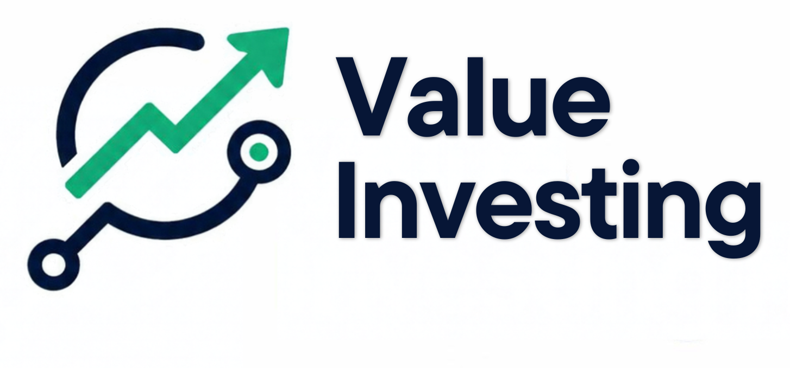
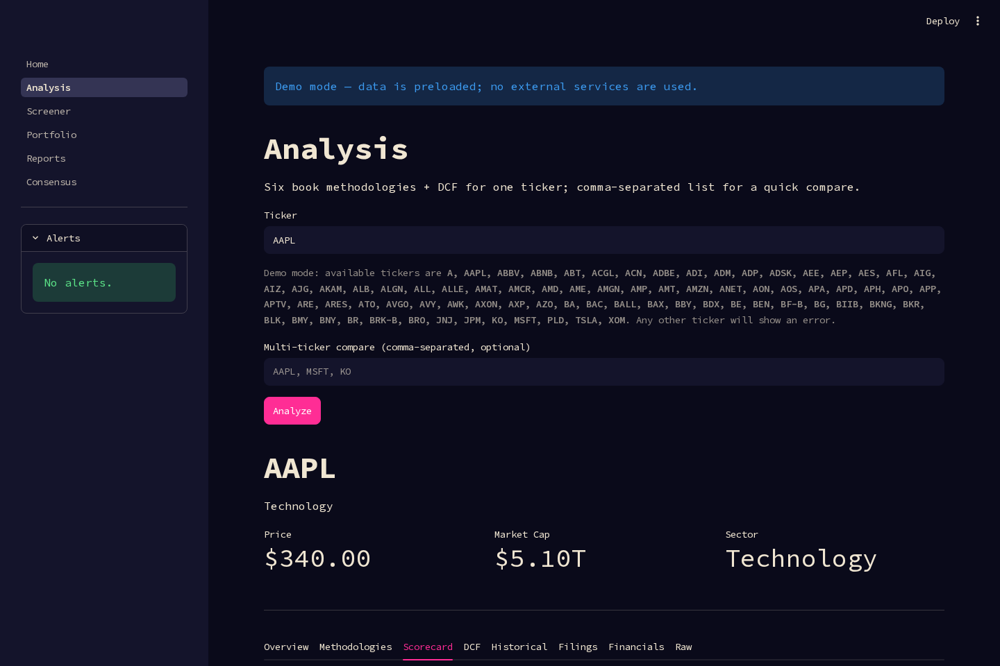

<p align="center">
  
</p>

# Value Investing

<p align="center">
  <a href="https://github.com/JdeJusto/Value_Investing/releases"></a>
  <a href="https://github.com/JdeJusto/Value_Investing/actions/workflows/ci.yml"></a>
  <a href="tests/unit"></a>
  <a href="LICENSE"></a>
  
  
  
  
</p>

<p align="center"><a href="README.md">English</a> · <a href="README.es.md">Español</a></p>

Análisis fundamental en la terminal para empresas cotizadas. Scorecards, un
screener, ocho metodologías de inversión independientes (Graham, Graham & Dodd,
Lynch, Buffett-Classic, Buffett-Clark, Fisher, Greenblatt, Marks), consenso y
DCF — tanto en CLI como en Streamlit. Los fundamentales se normalizan desde SEC
EDGAR en una base PostgreSQL local (Financial-DataBase).

## Instalación

Requiere Python 3.13 y una base PostgreSQL poblada por
[Financial-DataBase](https://github.com/JdeJusto/Financial-DataBase).

```bash
git clone https://github.com/JdeJusto/Value_Investing
cd Value_Investing
python -m pip install pipenv
PIPENV_VENV_IN_PROJECT=1 pipenv install --dev
pipenv shell
```

Los comandos siguientes se ejecutan desde la raíz del repositorio; `./vi` usa
el virtualenv del proyecto.

## CLI

```bash
./vi scorecard AAPL                           # Scorecard completa con veredictos
./vi financials AAPL                          # Balance (activos | pasivo+patrimonio)
./vi financials AAPL --json                   # Salida JSON estructurada
./vi rank --by graham --top 20                # Mejores tickers por metodología
./vi rank --combine graham,lynch --strategy and  # Intersección
./vi compare-methodologies AAPL                # Ocho metodologías de un vistazo
./vi dcf AAPL                                 # Resumen del DCF
./vi consensus AAPL --universe all             # Consenso canónico (las 8)
./vi portfolio view                           # Cartera actual
./vi screener --tickers AAPL,MSFT --no-prices --no-refresh  # Screener
./vi refresh AAPL                             # Re-sincroniza facts + precios de un ticker
./vi backtest --methodology graham --years 5   # Backtest de una metodología (PoC)
./vi screener --methodology graham:BUY         # Screener con filtro de metodología
```

`./vi --help` lista los 44 comandos. Ejecuta `vi` sin argumentos para abrir
el menú interactivo. Todos admiten `--no-color`; `vi financials`, `vi rank`,
`vi refresh` y `vi dcf` también admiten `--json`.
`vi financials` muestra una vista T jerárquica (activo corriente/no corriente,
pasivo corriente/no corriente, patrimonio neto) con subtotales por sección.
`vi refresh` sincroniza los facts de SEC y obtiene el precio actual de Yahoo
on-demand; los precios no se persisten en FDB.

Los precios vienen de yfinance por defecto. FMP y Tiingo se pueden usar
como proveedores opcionales (ver [docs/price_providers.md](docs/price_providers.md)).

Ver la [referencia completa del CLI](docs/cli_reference.md) para los 44 comandos, flags y ejemplos. ¿No recuerdas uno? `vi help --search <query>`.

## Streamlit



```bash
./run_ui.sh

# O con datos de demo (sin FDB):
VI_DEMO=1 ./run_ui.sh
```

Abre en <http://localhost:8501>. Páginas registradas: Inicio, Análisis (resumen,
estados financieros, metodologías, DCF, filings, evolución, peers), Screener,
Cartera, Informes y Consenso. El Análisis incluye gráficos de evolución a 10
años y un radar de comparación con peers. El ranking por metodología está
disponible en CLI con `vi rank`.

## Flujo diario

```bash
python scripts/daily_workflow.py
```

Sincroniza filings de la SEC y precios de Yahoo en FDB, evalúa alertas y genera
el informe diario. Admite `--resume` y health checks antes de cada etapa.
Códigos de salida: `0` éxito, `1` parcial, `2` no se pudo ejecutar. Véase
[`docs/runbook_daily.md`](docs/runbook_daily.md) para fallos y recuperación.

## Datos (FDB)

Requiere [Financial-DataBase](https://github.com/JdeJusto/Financial-DataBase)
en `~/Financial-DataBase` y una base PostgreSQL local con facts financieros,
precios y metadatos de compañías.

## Contribuir

Issues y PRs son bienvenidos.

```bash
pytest tests/unit tests/api             # tests
ruff check . && ruff format --check .   # lint
```

Véase [`docs/`](docs/) para notas de diseño y
[`docs/backlog.md`](docs/backlog.md) para problemas conocidos.

## Licencia

MIT — véase [`LICENSE`](LICENSE).
