<p align="center">
  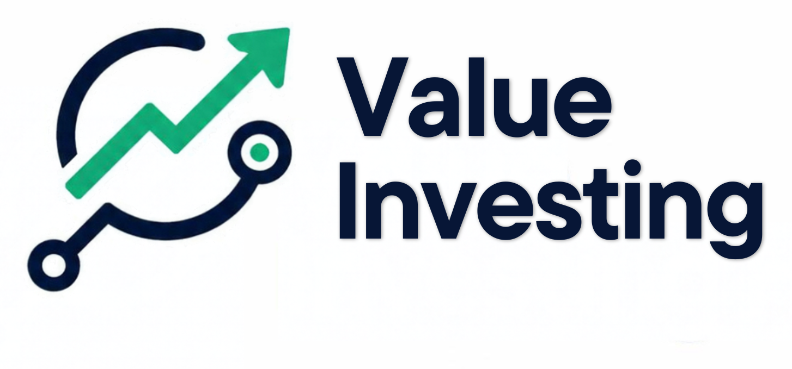
</p>

<h1 align="center">Value Investing</h1>

<p align="center">
  <em>Análisis fundamental en la terminal con ocho marcos de libro independientes,
  valoración DCF transparente y datos de presentaciones de la SEC.</em>
</p>

<p align="center">
  <a href="https://github.com/JdeJusto/Value_Investing/releases"></a>
  <a href="https://github.com/JdeJusto/Value_Investing/actions/workflows/ci.yml"></a>
  <a href="tests/unit"></a>
  <a href="LICENSE"></a>
  
  
  
  
</p>

<p align="center"><a href="README.md">English</a> · <a href="README.es.md">Español</a></p>

## Índice

- [Qué es esto](#qué-es-esto)
- [Inicio rápido](#inicio-rápido)
- [Qué hace](#qué-hace)
- [Las 8 metodologías](#las-8-metodologías)
- [Instalación](#instalación)
- [Uso](#uso)
- [Arquitectura](#arquitectura)
- [Motor de datos](#motor-de-datos)
- [Aplicación móvil](#aplicación-móvil)
- [Hoja de ruta](#hoja-de-ruta)
- [Preguntas frecuentes](#preguntas-frecuentes)

## Qué es esto

Value Investing ejecuta ocho marcos de inversión independientes sobre los mismos
datos financieros. Cada marco procede de un libro publicado o de una regla
interna documentada, así que puedes ver qué concluye cada uno, dónde discrepan y
el razonamiento detrás de cada decisión. Lee fundamentales derivados de la SEC
desde la base de datos complementaria Financial-DataBase, opcional, recurre a
JSON local como alternativa y obtiene precios bajo demanda sin persistirlos
nunca. Está pensado para inversores en valor que quieren un análisis trazable y
determinista en lugar de una única puntuación opaca.

## Inicio rápido

Prueba el paquete offline con datos fijados, sin PostgreSQL, sin acceso a la SEC
y sin Yahoo.


```bash
git clone https://github.com/JdeJusto/Value_Investing.git
cd Value_Investing
python -m pip install pipenv
PIPENV_VENV_IN_PROJECT=1 pipenv install --dev

python main.py analyze-full AAPL --demo
VI_DEMO=1 ./run_ui.sh   # http://localhost:8501
```

El modo demo incluye ocho tickers fijados: AAPL, MSFT, KO, JNJ, JPM, XOM, PLD y
TSLA. No usa servicios externos.

## Qué hace

Ocho marcos evalúan la misma empresa de forma independiente, así que lo
interesante es el patrón de acuerdos y desacuerdos. La vista de consenso explica
por qué las familias llegan a veredictos distintos en lugar de ocultar el
conflicto dentro de una única puntuación promediada.

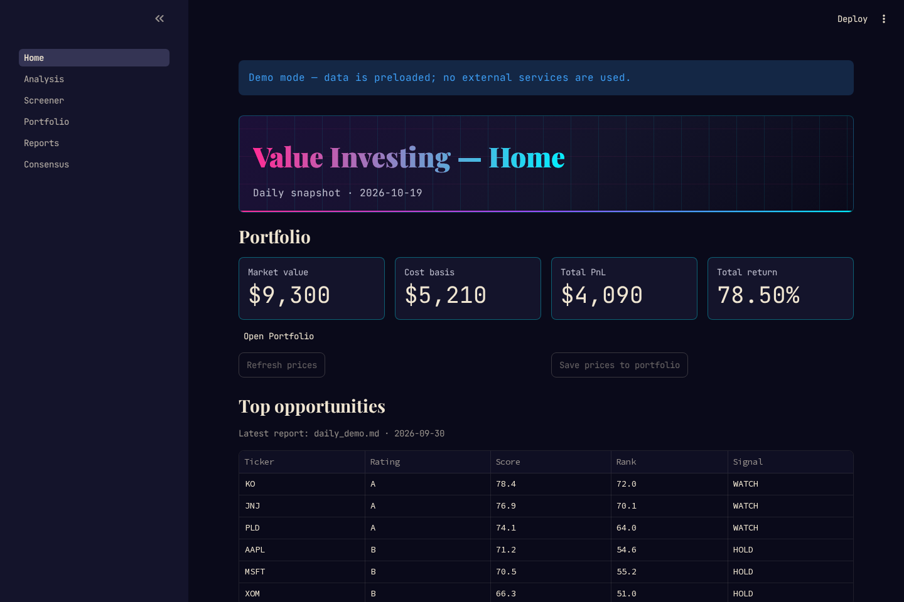

*La página de inicio: valor de la cartera, mejores oportunidades y alertas recientes.*


*Recorrido por las páginas de Inicio, Análisis, Consenso y Cartera.*

Los estados financieros se pueden consultar por estado y ejercicio fiscal,
incluidos conceptos que no se asignan a campos de análisis. Las ideas
automáticas cubren crecimiento, variaciones interanuales, CAGR, tendencia,
estabilidad y cambios de dirección. Las alertas deterministas sobre liquidez,
margen, deuda, flujo de caja libre, ingresos, calidad de resultados y dividendos
incluyen sus pruebas.


*Pestañas de estados con datos interanuales e ideas automáticas.*

El screener de consenso clasifica empresas según los ocho veredictos, compara
las categorías de Lynch y abre la zona de desacuerdo de cualquier ticker.

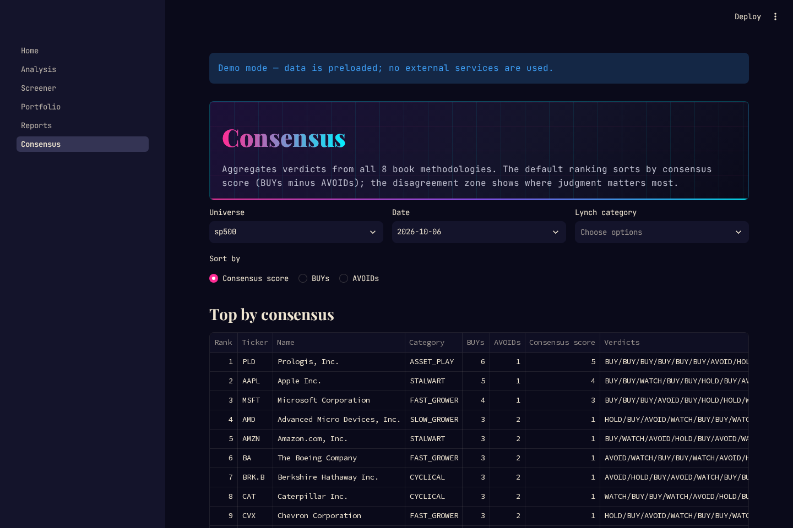

*Ranking de consenso, desglose por categorías y zona de desacuerdo.*

El DCF es una valoración complementaria etiquetada como `not-from-canon`. Vive
fuera del registro de metodologías y nunca modifica un veredicto de libro. Cinco
rutas cubren el flujo de caja libre estándar, los fondos de operaciones de los
REIT, modelos DDM financieros de dos y una etapa (con dividendos), y empresas de
hipercrecimiento. Véanse las [notas de diseño del DCF](backend/valuation/README.md)
para supuestos y fórmulas.

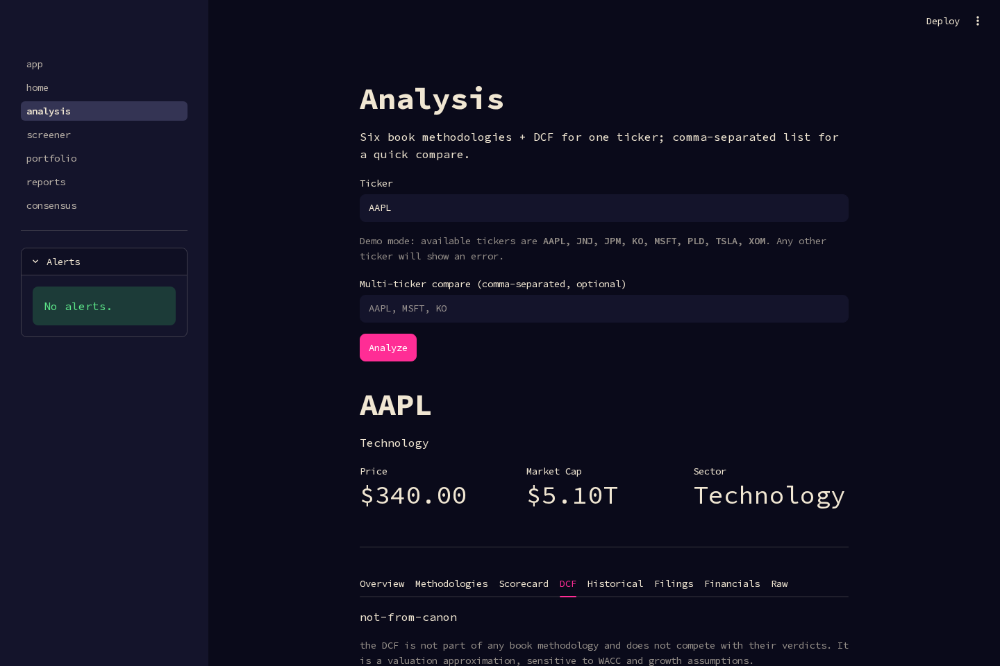

*Valor intrínseco del DCF, margen de seguridad, supuestos y sensibilidad.*

La pestaña **Scorecard** resume el mismo análisis en seis dimensiones —Crecimiento,
Rentabilidad, Salud Financiera, Valoración, Retribución al Accionista,
Gestión/Foso— con un radar de seis ejes, tarjetas que muestran las reglas detrás
de cada puntuación, cuatro gráficos de histórico (ingresos y beneficio neto,
márgenes, ROE y ROIC, valor DCF frente a precio) y un panel explícito cuando las
dimensiones discrepan. Es un resumen de los servicios existentes, nunca una
"puntuación maestra", y la carga congelada se puede descargar como JSON o
Markdown (`--markdown` en la CLI, `?format=markdown` en la API o el botón de
descarga de la pestaña).

Cuando existe un grupo de comparación (*peers*) —un artefacto que se regenera
los domingos a partir de Financial-DataBase sobre el universo maestro y que se
guarda en caché local, nunca en el repositorio— la tabla de reglas añade la
**mediana del grupo** y el percentil de la empresa, y la valoración compara su
PER con el del grupo. La comparación es solo informativa: ningún percentil
cambia una puntuación ni un umbral.

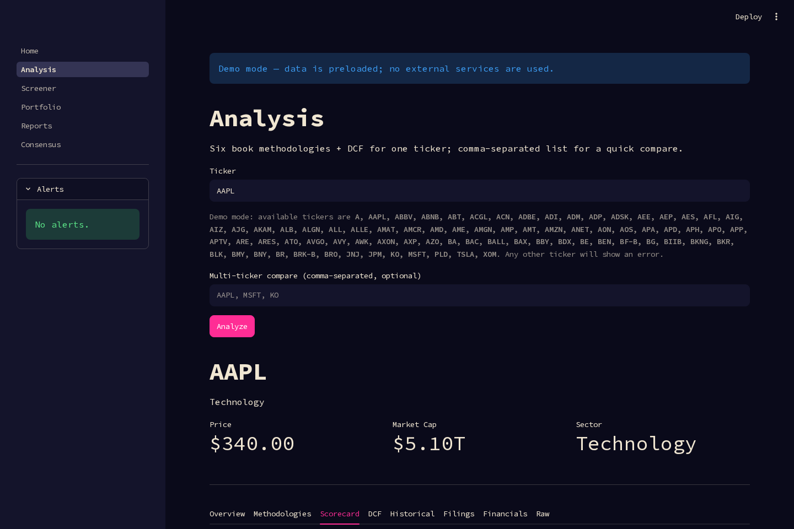

*La pestaña Scorecard: el radar, las tarjetas de dimensión y los gráficos.*

## Las 8 metodologías

| Metodología | Fuente | Familia | Qué busca |
|---|---|---|---|
| `graham` | *The Intelligent Investor* (1949) | `DEEP_VALUE` | Criterios defensivos, solidez financiera y el test de valoración 22,5 |
| `graham_dodd` | *Security Analysis* (1934) | `DEEP_VALUE` | Capital circulante neto, estabilidad de beneficios y cobertura de cargas fijas |
| `buffett_classic` | Marco interno de cuatro pilares | `QUALITY_COMPOUNDER` | Rentabilidad, solidez financiera, generación de caja y estabilidad |
| `buffett_clark` | *Warren Buffett and the Interpretation of Financial Statements* | `QUALITY_COMPOUNDER` | Márgenes duraderos, carga de intereses y señales de beneficio del propietario |
| `fisher_quantitative_subset` | *Common Stocks and Uncommon Profits* (1958) | `QUALITY_COMPOUNDER` | Subconjunto cuantitativo: intensidad de I+D, márgenes y dilución |
| `lynch_garp` | *One Up on Wall Street* (1989) | `GARP` | PEG, crecimiento de beneficios y categorías de empresa de Lynch |
| `marks` | *The Most Important Thing* (2011) | `CYCLE_AWARE_VALUE` | Posición en el ciclo, resiliencia, apalancamiento y margen de seguridad |
| `greenblatt` | *The Little Book That Beats the Market* (2005) | `MAGIC_FORMULA` | Ranking de rentabilidad sobre capital y rentabilidad de beneficios |

Los marcos comparten los mismos fundamentales normalizados y la misma interfaz de
precios, pero nunca leen la salida de los demás, así que dos de ellos pueden
discrepar sin que ninguno esté equivocado. Las reglas de libro se abstienen en
los tipos de empresa que no encajan con sus supuestos, incluidos bancos y
aseguradoras.

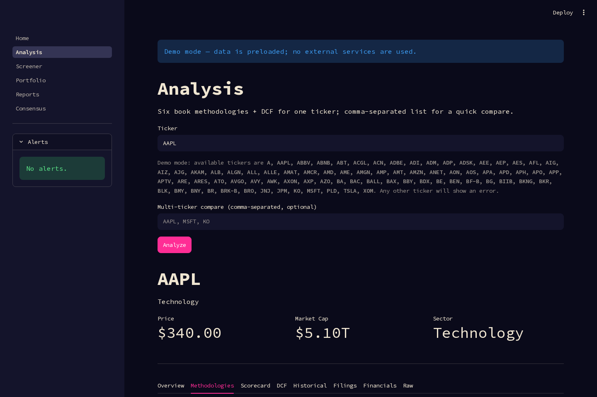

*Ocho veredictos independientes para una misma empresa.*

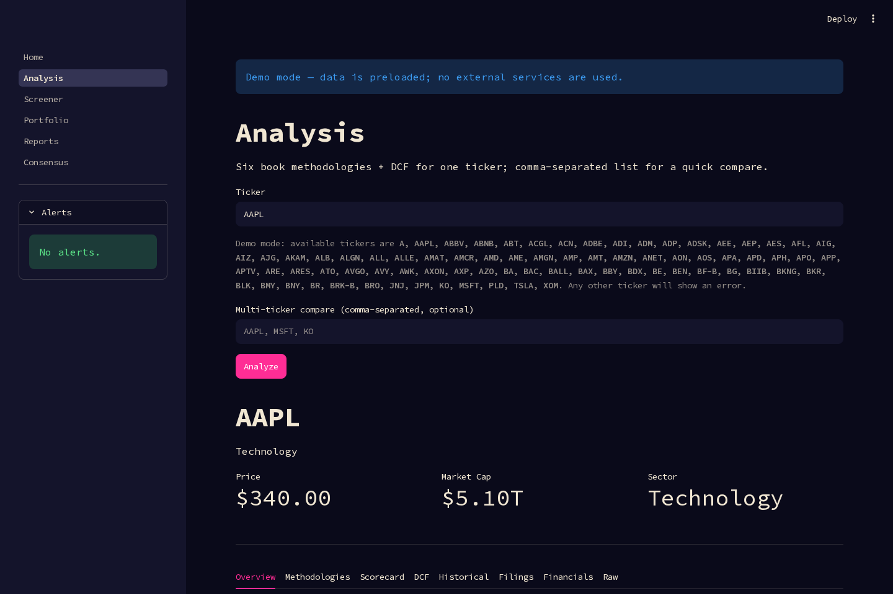

*Un resumen de desacuerdos que explica los veredictos en lugar de promediarlos.*


*Comparar dos metodologías lado a lado: dónde coinciden y dónde no.*

Véanse las [decisiones de metodología](docs/methodology_decisions.md), la [metodología de puntuación](docs/scoring_methodology.md) y la [validación de puntuaciones](docs/scoring_validation.md).

## Instalación

Requisitos: Python 3.13+ y Pipenv. Se recomienda una instancia PostgreSQL de
Financial-DataBase accesible para el conjunto completo de datos derivados de la
SEC; las rutas de JSON local y la demo offline funcionan sin ella.

```bash
python -m pip install pipenv
PIPENV_VENV_IN_PROJECT=1 pipenv install --dev
cp .env.example .env
source .venv/bin/activate
```

Antes de hacer peticiones a la SEC, configura `SEC_USER_AGENT` con el nombre
descriptivo de la aplicación y una dirección de contacto real, y define
`SEC_EMAIL` y `SEC_NAME` para el proveedor directo `edgartools`. No publiques
`.env` ni credenciales. Todas las opciones están documentadas en
[`.env.example`](.env.example).

## Uso

### CLI

```bash
./vi analyze-full AAPL
./vi compare-methodologies AAPL
./vi consensus AAPL
./vi consensus-ranking --universe sp500 --top 20
./vi consensus-by-category --universe sp500 --per-category 5
```

La salida se renderiza con [Rich](https://github.com/Textualize/rich): paneles
con borde y tablas enmarcadas en la terminal, además de indicadores de progreso
para ejecuciones largas. La salida redirigida nunca contiene códigos de color, y
`NO_COLOR=1` o `--no-color` desactivan el color también en la terminal. Si
prefieres un menú a las banderas, usa `./vi interactive`.

Los comandos de consenso leen el último informe precalculado. Actualízalo con
`python -m scripts.compute_consensus_rankings --universe sp500`.

### Interfaz Streamlit

```bash
./run_ui.sh
```

Las seis páginas son Inicio, Análisis, Screener, Cartera, Informes y Consenso.
Para un recorrido sin base de datos, usa `VI_DEMO=1 ./run_ui.sh`.

La interfaz sigue el sistema de diseño synthwave: fondo de noche profunda,
acentos rosa/cian neón, toques dorados, cabeceras serif y tipografía
monoespaciada en el cuerpo. La paleta, las clases de componentes y las reglas
de accesibilidad están documentadas en
[docs/ui_design_system.md](docs/ui_design_system.md).


*El tema en Inicio: banda de cabecera, tarjetas de métricas y severidades de alerta en neón.*

### Filings

```bash
python main.py filings AAPL --form 10-K,10-Q --year 2025
python main.py filing-statement AAPL --type balance_sheet
python main.py filing-section AAPL --type risk_factors --word-limit 500
```

La pestaña Filings enlaza a los documentos originales de la SEC y puede cargar
vistas previas de estados o narrativas. Los documentos analizados se almacenan en
caché local bajo `data/raw/filings/`.

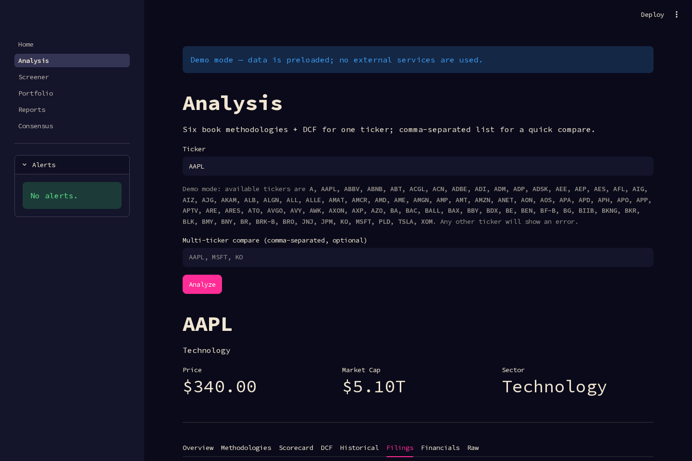

*Presentaciones de la SEC con enlaces de origen y vistas previas de estados.*

Véanse la [extracción de filings](docs/filings_extraction.md) y las [notas de extracción de narrativas](docs/narrative_extraction.md).

### Cartera y screener

```bash
./vi portfolio view
./vi portfolio add AAPL 10 180.00 --thesis "moat"
./vi screener --tickers AAPL,MSFT
python -m scripts.daily_workflow --dry-run --limit 5 --top 3
```

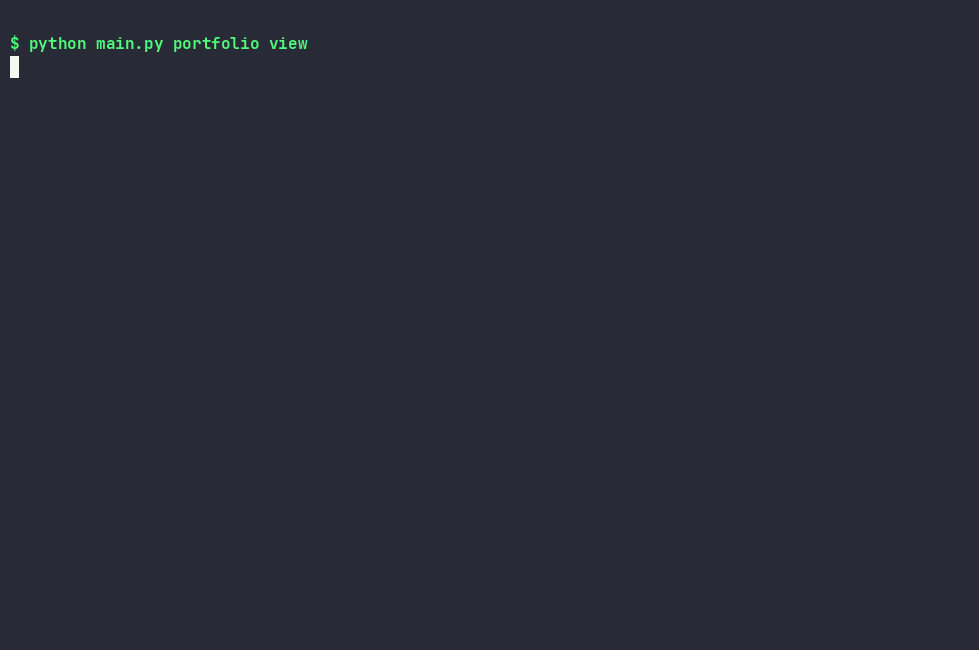

*Consulta, alta y rendimiento de la cartera desde la terminal.*

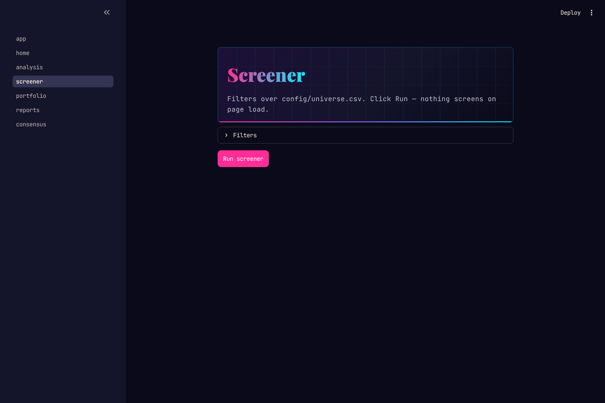

*Resultados del screener filtrados por sector y veredicto.*

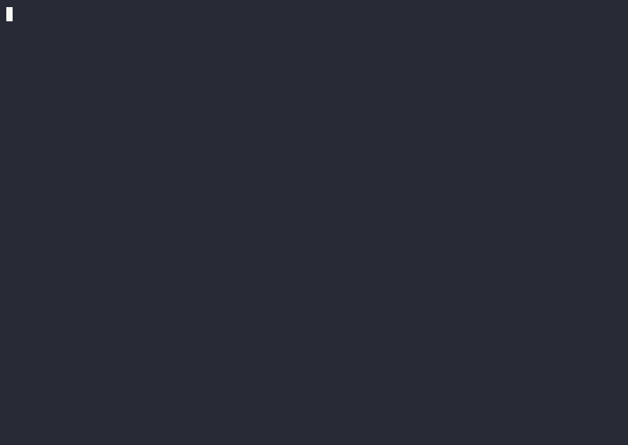

*Filtrar el screener por sector y veredicto y leer las filas clasificadas.*

Véase el [runbook diario](docs/runbook_daily.md) para opciones de actualización, reanudación e informes.

## Arquitectura

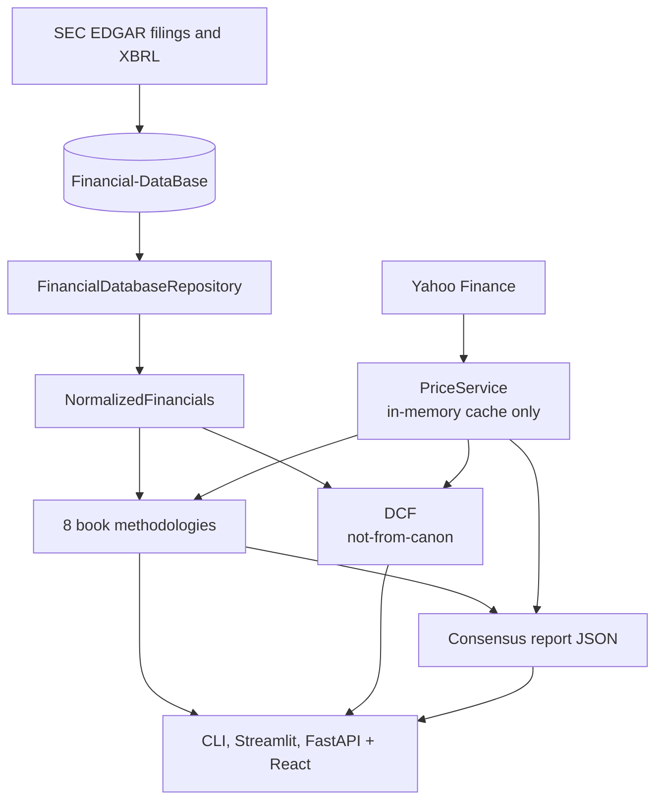

El dominio usa objetos Python simples, mientras que proveedores y repositorios
viven en los bordes. Cada metodología recibe los mismos fundamentales
normalizados y la misma interfaz de precios, y el DCF se mantiene separado de los
veredictos de libro. Más detalle: [arquitectura](docs/architecture.md) y [diseño del consenso](docs/consensus_screener.md).

## Motor de datos

La aplicación lee fundamentales derivados de la SEC desde el proyecto
complementario [Financial-DataBase](https://github.com/JdeJusto/Financial-DataBase)
(PostgreSQL) como fuente de solo lectura, con JSON local como alternativa. Yahoo
Finance proporciona precios bajo demanda que se almacenan en memoria y nunca se
escriben en una base de datos; las instantáneas de precios del consenso son
archivos de informe, no un almacén de precios. La demo offline no necesita
servicios externos. Una **auditoría de calidad de datos** recurrente —una
validación semanal por muestreo y una clasificación mensual de cada diferencia
Financial-DataBase ↔ SEC ↔ Yahoo— vigila el pipeline; sus clases de diferencias
esperadas están documentadas en la
[investigación de lagunas de datos](docs/data_gaps_investigation.md).

Véanse las [fuentes de datos](docs/data-sources.md), la [investigación de lagunas de datos](docs/data_gaps_investigation.md), la [metodología de validación](docs/validation_methodology.md) y el [índice de documentación](docs/README.md).

## Aplicación móvil

Una aplicación nativa de Android consume el backend FastAPI. Su pantalla de
inicio muestra datos de empresa en vivo, y la pantalla de detalle incluye cinco
pestañas: Overview, Methodologies, DCF, Financials y Filings. Las pestañas
principales Screener, Consensus y Portfolio están implementadas con un universo
filtrable, rankings de consenso por categoría y una cartera en vivo. Requiere el
servidor de API en ejecución local; véanse [`mobile/README.md`](mobile/README.md) y el
[diseño de la API](docs/api_design.md).

Descarga `value-investing-<version>-arm64-v8a.apk` desde la
[última versión](https://github.com/JdeJusto/Value_Investing/releases/latest),
instálala (habilitando «Instalar desde orígenes desconocidos») y configura la URL
de la API en Ajustes.

## Hoja de ruta

- [x] Ocho metodologías de libro independientes y variantes DCF separadas
- [x] Estados financieros, ideas, alertas deterministas y vistas previas de filings
- [x] Rankings de consenso, instantáneas de precios y vista de zona de desacuerdo
- [x] Backend FastAPI consumido por la aplicación móvil — véase [#27](https://github.com/JdeJusto/Value_Investing/issues/27) ([diseño](docs/api_design.md))
- [ ] Automatización semanal de los rankings de consenso y Greenblatt
- [ ] Notificaciones de alertas en tiempo real
- [ ] Mayor cobertura de metodologías documentadas

Véase el [backlog de ingeniería](docs/backlog.md) para los siguientes pasos.

## Preguntas frecuentes

**¿Por qué ocho metodologías en lugar de una única puntuación compuesta?**

Una puntuación compuesta puede ocultar los desacuerdos. Los marcos independientes
responden a preguntas distintas, y la interfaz muestra sus veredictos y razones
lado a lado.

**¿Por qué el DCF está etiquetado como `not-from-canon`?**

Las metodologías de libro no prescriben este DCF. Es un modelo de valoración
práctico, mantenido aparte para que no pueda alterar de forma silenciosa las
puntuaciones derivadas de los libros.

**¿Se guardan los precios de mercado?**

Los precios nunca se escriben en una base de datos. Las cotizaciones se obtienen
bajo demanda y se almacenan en memoria. Los informes JSON de consenso pueden
incluir una instantánea de precio para reproducibilidad.

**¿Puedo analizar bancos y aseguradoras?**

Las reglas de libro se abstienen cuando sus supuestos no encajan con empresas
financieras. La pestaña Financials sigue mostrando los datos almacenados, y el
DCF tiene variantes de descuento de dividendos para financieras.

**¿Necesito Financial-DataBase?**

Es la fuente recomendada para fundamentales completos de la SEC. Las rutas de
JSON local y la demo offline están disponibles para explorar.

**¿El proyecto usa un LLM?**

No. Las reglas de análisis, los veredictos, las ideas y las alertas son
deterministas.

## Pruebas

```bash
python -m pytest tests/unit -q
python -m pytest tests/api -q
ruff check .
ruff format --check .
```

La suite unitaria es hermética y no necesita base de datos. El script de release
actualiza el badge con el conteo de tests. La cobertura aún no se mide.

## Contribuir

Las incidencias y los pull requests son bienvenidos; véanse [CONTRIBUTING.md](CONTRIBUTING.md),
el [Código de conducta](CODE_OF_CONDUCT.md) y [Seguridad](SECURITY.md). Las
contribuciones pasadas aparecen en el
[gráfico de colaboradores](https://github.com/JdeJusto/Value_Investing/graphs/contributors).

## Licencia

[MIT](LICENSE). La licencia cubre el código de este repositorio, no los datos
proporcionados por proveedores externos.

## Historial de estrellas

[](https://star-history.com/#JdeJusto/Value_Investing&Date)

## Agradecimientos

- Los autores cuyos libros inspiran las reglas de inversión documentadas.
- [SEC EDGAR](https://www.sec.gov/edgar) por las presentaciones públicas y los datos de empresas.
- [Financial-DataBase](https://github.com/JdeJusto/Financial-DataBase) por el motor de datos complementario derivado de la SEC.
- [Streamlit](https://streamlit.io/) por la interfaz y [yfinance](https://github.com/ranaroussi/yfinance) por los datos de mercado bajo demanda.
