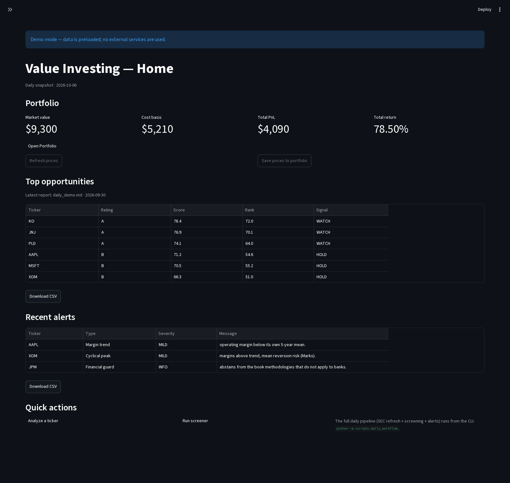
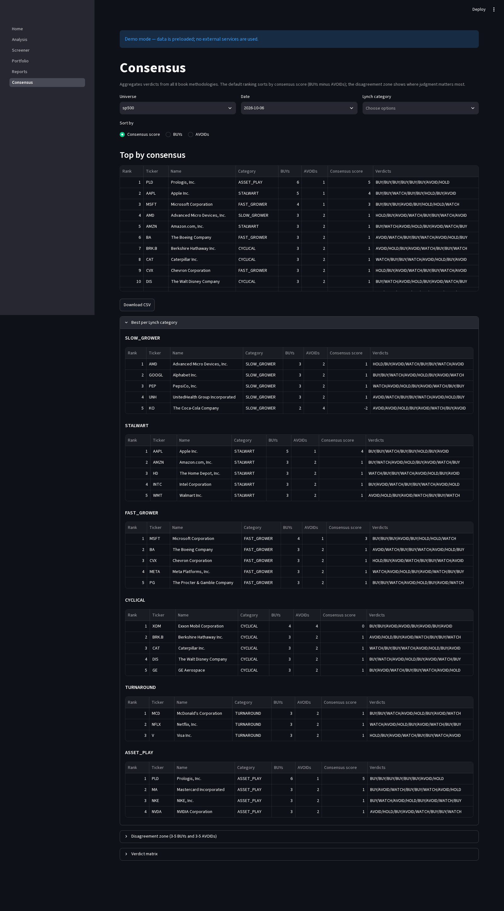
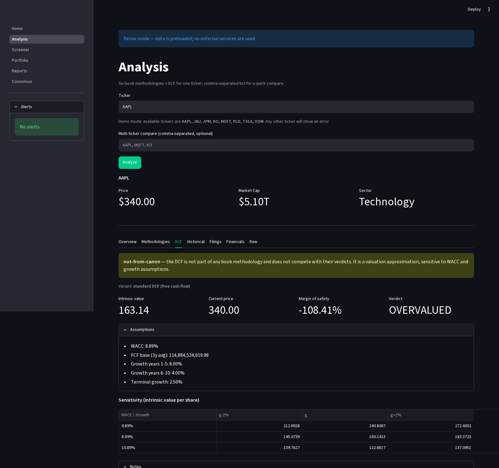
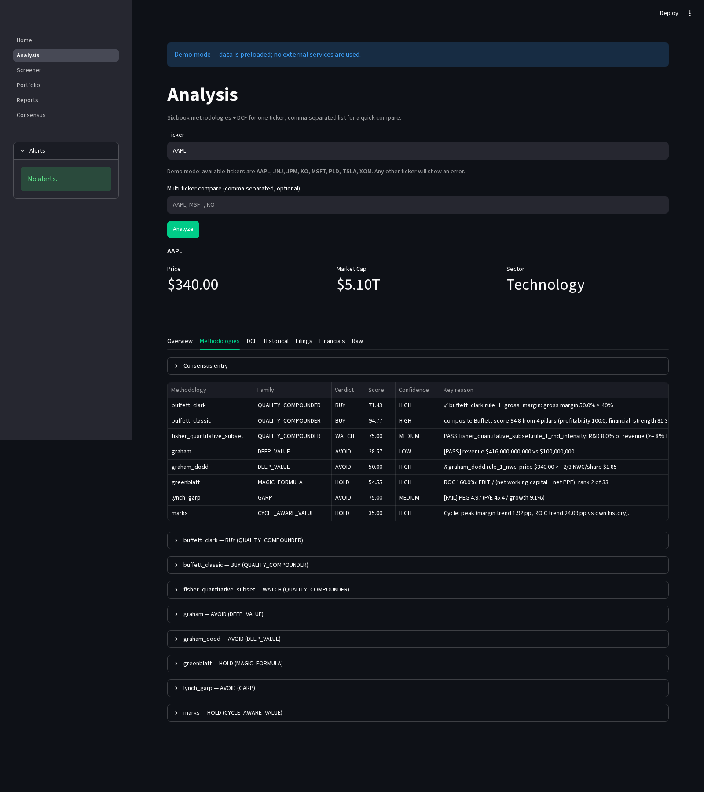
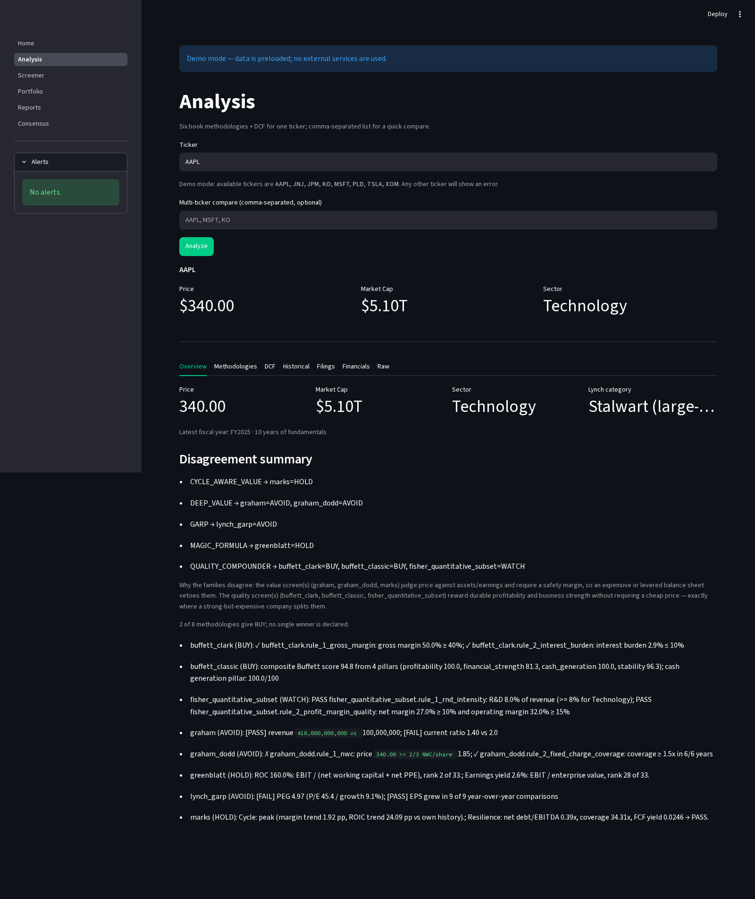
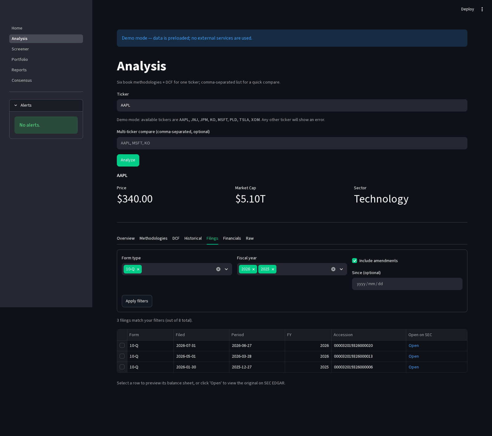
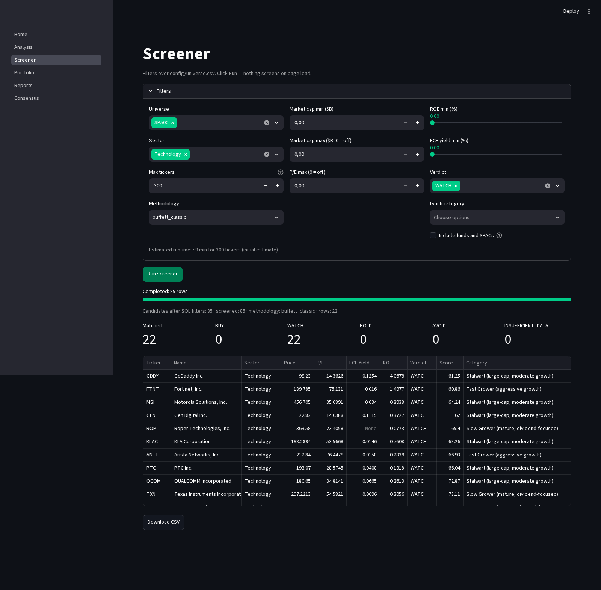
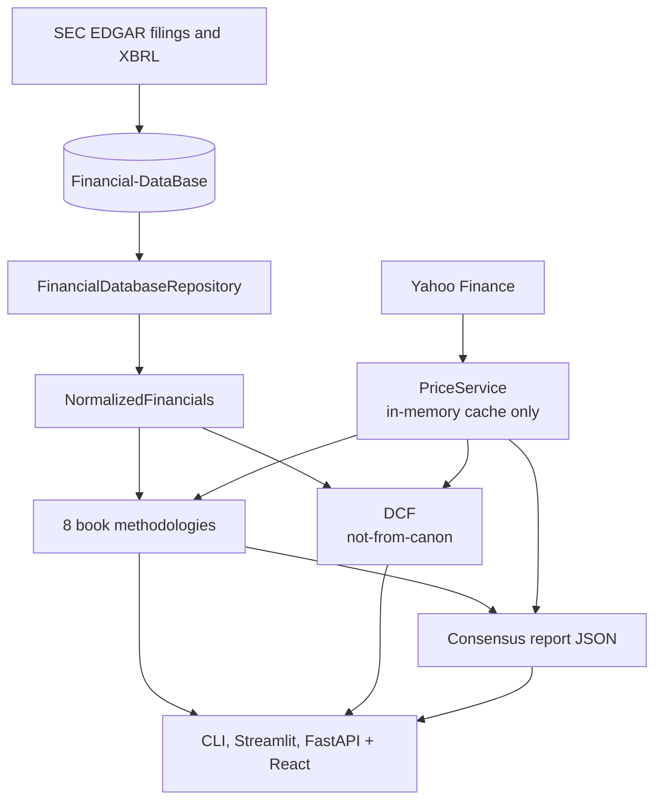

<p align="center">
  
</p>

<h1 align="center">Value Investing</h1>

<p align="center">
  <em>Terminal-first fundamental analysis with eight independent book frameworks,
  transparent DCF valuation, and SEC filing data.</em>
</p>

<p align="center">
  <a href="https://github.com/JdeJusto/Value_Investing/releases"></a>
  <a href="https://github.com/JdeJusto/Value_Investing/actions/workflows/ci.yml"></a>
  <a href="tests/unit"></a>
  <a href="LICENSE"></a>
  
  
  
  
</p>

<p align="center"><a href="README.md">English</a> · <a href="README.es.md">Español</a></p>

## Table of contents

- [What is this](#what-is-this)
- [Quick start](#quick-start)
- [What it does](#what-it-does)
- [The 8 methodologies](#the-8-methodologies)
- [Installation](#installation)
- [Usage](#usage)
- [Architecture](#architecture)
- [Data engine](#data-engine)
- [Mobile app](#mobile-app)
- [Roadmap](#roadmap)
- [FAQ](#faq)

## What is this

Value Investing runs eight independent investment frameworks against the same
financial facts. Every framework comes from a published book or a documented
internal rule, so you can see what each one concludes, where they disagree, and
the reasoning behind each call. It reads SEC-derived fundamentals from the
optional companion Financial-DataBase, falls back to local JSON, and fetches
prices on demand without ever persisting them. It is built for value investors
who want traceable, deterministic analysis instead of one opaque composite
score.

## Quick start

Try the pinned offline bundle without PostgreSQL, SEC access, or Yahoo.


```bash
git clone https://github.com/JdeJusto/Value_Investing.git
cd Value_Investing
python -m pip install pipenv
PIPENV_VENV_IN_PROJECT=1 pipenv install --dev

python main.py analyze-full AAPL --demo
VI_DEMO=1 ./run_ui.sh   # http://localhost:8501
```

Demo mode ships eight pinned tickers: AAPL, MSFT, KO, JNJ, JPM, XOM, PLD, and
TSLA. It uses no external services.

## What it does

Eight frameworks evaluate the same company independently, so the interesting
output is the pattern of agreement and disagreement. The consensus view
explains why families reach different verdicts instead of hiding the conflict
inside a single averaged score.



*The Home page: portfolio value, top opportunities, and recent alerts.*


*Moving between the Home, Analysis, Consensus, and Portfolio pages.*

Financial statements are browsable by statement and fiscal year, including
concepts that are not mapped to analysis fields. Automatic insights cover
growth, year-over-year changes, CAGR, trend, stability, and direction changes.
Deterministic alerts on cash runway, margin, debt, free cash flow, revenue,
earnings quality, and dividends each carry their evidence.


*Statement tabs with year-over-year facts and automatic insights.*

The consensus screener ranks companies across all eight verdicts, compares
Lynch categories, and opens the disagreement zone for any ticker.



*Consensus ranking, category breakdowns, and the disagreement zone.*

The DCF is a supplementary valuation labeled `not-from-canon`. It lives outside
the methodology registry and never changes a book verdict. Five routes cover
standard free cash flow, REIT funds from operations, two-stage and single-stage
financial dividend discount models, and hyper-growth companies. See
[the DCF design notes](backend/valuation/README.md) for assumptions and formulas.



*DCF intrinsic value, margin of safety, assumptions, and sensitivity.*

## The 8 methodologies

| Methodology | Source | Family | What it looks for |
|---|---|---|---|
| `graham` | *The Intelligent Investor* (1949) | `DEEP_VALUE` | Defensive criteria, financial strength, and the 22.5 valuation test |
| `graham_dodd` | *Security Analysis* (1934) | `DEEP_VALUE` | Net working capital, earnings stability, and fixed-charge coverage |
| `buffett_classic` | Internal four-pillar framework | `QUALITY_COMPOUNDER` | Profitability, financial strength, cash generation, and stability |
| `buffett_clark` | *Warren Buffett and the Interpretation of Financial Statements* | `QUALITY_COMPOUNDER` | Durable margins, interest burden, and owner-earnings signals |
| `fisher_quantitative_subset` | *Common Stocks and Uncommon Profits* (1958) | `QUALITY_COMPOUNDER` | Quantitative subset: R&D intensity, margins, and dilution |
| `lynch_garp` | *One Up on Wall Street* (1989) | `GARP` | PEG, earnings growth, and Lynch company categories |
| `marks` | *The Most Important Thing* (2011) | `CYCLE_AWARE_VALUE` | Cycle position, resilience, leverage, and margin of safety |
| `greenblatt` | *The Little Book That Beats the Market* (2005) | `MAGIC_FORMULA` | Return on capital and earnings yield ranking |

The frameworks share the same normalized fundamentals and price interface but
never read each other's output, so two of them can disagree without either being
wrong. Book rules abstain from company types their assumptions do not fit,
including banks and insurers.



*Eight independent verdicts for one company.*



*A disagreement summary that explains the verdicts instead of averaging them.*


*Comparing two methodologies side by side: where they agree and where they don't.*

See the [methodology decisions](docs/methodology_decisions.md), [scoring methodology](docs/scoring_methodology.md), and [scoring validation](docs/scoring_validation.md).

## Installation

Requirements: Python 3.13+ and Pipenv. A reachable Financial-DataBase
PostgreSQL instance is recommended for the full SEC-derived data set; local JSON
paths and the offline demo work without it.

```bash
python -m pip install pipenv
PIPENV_VENV_IN_PROJECT=1 pipenv install --dev
cp .env.example .env
source .venv/bin/activate
```

Before SEC requests, set `SEC_USER_AGENT` to a descriptive application name and
a real contact address, and set `SEC_EMAIL` and `SEC_NAME` for the direct
`edgartools` provider. Never commit `.env` or credentials. Every setting is
documented in [`.env.example`](.env.example).

## Usage

### CLI

```bash
./vi analyze-full AAPL
./vi compare-methodologies AAPL
./vi consensus AAPL
./vi consensus-ranking --universe sp500 --top 20
./vi consensus-by-category --universe sp500 --per-category 5
```

Output is rendered with [Rich](https://github.com/Textualize/rich): bordered
panels and framed tables on a terminal, plus spinners and progress bars for long
runs. Redirected output never contains color codes, and `NO_COLOR=1` or
`--no-color` turns color off on a terminal as well. Prefer a menu over flags
with `./vi interactive`.

Consensus commands read the latest precomputed report. Refresh it with
`python -m scripts.compute_consensus_rankings --universe sp500`.

### Streamlit UI

```bash
./run_ui.sh
```

The six pages are Home, Analysis, Screener, Portfolio, Reports, and Consensus.
For a database-free walkthrough, use `VI_DEMO=1 ./run_ui.sh`.

### Filings

```bash
python main.py filings AAPL --form 10-K,10-Q --year 2025
python main.py filing-statement AAPL --type balance_sheet
python main.py filing-section AAPL --type risk_factors --word-limit 500
```

The Filings tab links to SEC source documents and can load statement or narrative
previews. Parsed documents are cached locally under `data/raw/filings/`.



*SEC filings with source links and statement previews.*

See [filing extraction](docs/filings_extraction.md) and [narrative extraction](docs/narrative_extraction.md).

### Portfolio and screener

```bash
./vi portfolio view
./vi portfolio add AAPL 10 180.00 --thesis "moat"
./vi screener --tickers AAPL,MSFT
python -m scripts.daily_workflow --dry-run --limit 5 --top 3
```


*Portfolio view, add, and performance from the terminal.*



*Screener results filtered by sector and verdict.*


*Filtering the screener by sector and verdict, then reading the ranked rows.*

See the [daily runbook](docs/runbook_daily.md) for refresh, resume, and reporting options.

## Architecture



The domain uses plain Python objects, while providers and repositories live at
the edges. Every methodology receives the same normalized fundamentals and price
interface, and the DCF stays separate from book verdicts. More detail:
[architecture](docs/architecture.md) and [consensus design](docs/consensus_screener.md).

## Data engine

The app reads SEC-derived fundamentals from the companion
[Financial-DataBase](https://github.com/JdeJusto/Financial-DataBase) PostgreSQL
project as a read-only source, with local JSON as a fallback. Yahoo Finance
provides on-demand prices that are cached in memory and never written to a
database; consensus price snapshots are report files, not a price store. The
offline demo needs no external services.

See [data sources](docs/data-sources.md), the [data-gap investigation](docs/data_gaps_investigation.md), the [validation methodology](docs/validation_methodology.md), and the full [documentation index](docs/README.md).

## Mobile app

A native Android app consumes the FastAPI backend. Its Home screen renders live
company data, and the company detail screen ships five tabs: Overview,
Methodologies, DCF, Financials, and Filings. The top-level Screener, Consensus,
and Portfolio tabs are implemented with a filterable universe, consensus
rankings by category, and a live portfolio. It requires the API server running
locally; see [`mobile/README.md`](mobile/README.md) and [the API design](docs/api_design.md).

Download `value-investing-<version>-arm64-v8a.apk` from the
[latest release](https://github.com/JdeJusto/Value_Investing/releases/latest),
install it (enabling "Install from unknown sources"), and set the API URL in
Settings.

## Roadmap

- [x] Eight independent book methodologies and separate DCF variants
- [x] Financial statements, insights, deterministic alerts, and filing previews
- [x] Consensus rankings, price snapshots, and disagreement-zone view
- [x] FastAPI backend consumed by the mobile app — see [#27](https://github.com/JdeJusto/Value_Investing/issues/27) ([design](docs/api_design.md))
- [ ] Weekly automation for consensus and Greenblatt rankings
- [ ] Real-time alert notifications
- [ ] Broader documented methodology coverage

See the [engineering backlog](docs/backlog.md) for follow-up items.

## FAQ

**Why eight methodologies instead of one composite score?**

A composite can hide disagreement. Independent frameworks answer different
questions, and the UI shows their verdicts and reasons side by side.

**Why is the DCF labeled `not-from-canon`?**

The book methodologies do not prescribe this DCF. It is a practical valuation
model, kept separate so it cannot silently affect book-derived scores.

**Are market prices stored?**

Prices are never written to a database. Quotes are fetched on demand and cached
in memory. Consensus JSON reports may contain a price snapshot for
reproducibility.

**Can I analyze banks and insurers?**

Book rules abstain where their assumptions do not fit financial companies. The
Financials tab still shows stored facts, and the DCF has dividend-discount
variants for financials.

**Do I need Financial-DataBase?**

It is the recommended source for full SEC fundamentals. Local JSON fallback
paths and the offline demo are available for exploration.

**Does the project use an LLM?**

No. Analysis rules, verdicts, insights, and alerts are deterministic.

## Tests

```bash
python -m pytest tests/unit -q
python -m pytest tests/api -q
ruff check .
ruff format --check .
```

The unit suite is hermetic and needs no database. The test-count badge is
refreshed by the release script. Coverage is not currently measured.

## Contributing

Issues and pull requests are welcome; see [CONTRIBUTING.md](CONTRIBUTING.md), the
[Code of Conduct](CODE_OF_CONDUCT.md), and [Security](SECURITY.md). Past
contributions are listed in the
[contributors graph](https://github.com/JdeJusto/Value_Investing/graphs/contributors).

## License

[MIT](LICENSE). The license covers this repository's code, not data supplied by
external providers.

## Star history

[](https://star-history.com/#JdeJusto/Value_Investing&Date)

## Acknowledgments

- The authors whose books inform the documented investment rules.
- [SEC EDGAR](https://www.sec.gov/edgar) for public filings and company facts.
- [Financial-DataBase](https://github.com/JdeJusto/Financial-DataBase) for the companion SEC-derived data engine.
- [Streamlit](https://streamlit.io/) for the UI and [yfinance](https://github.com/ranaroussi/yfinance) for on-demand market data.
