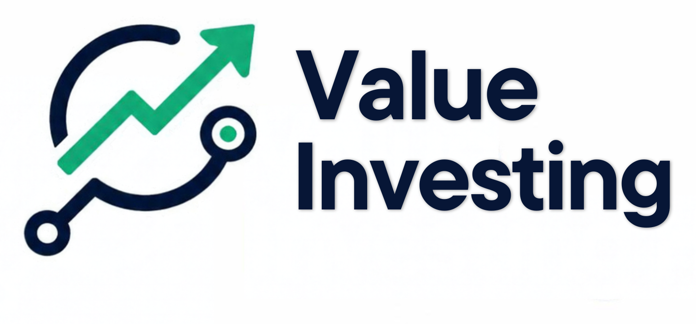
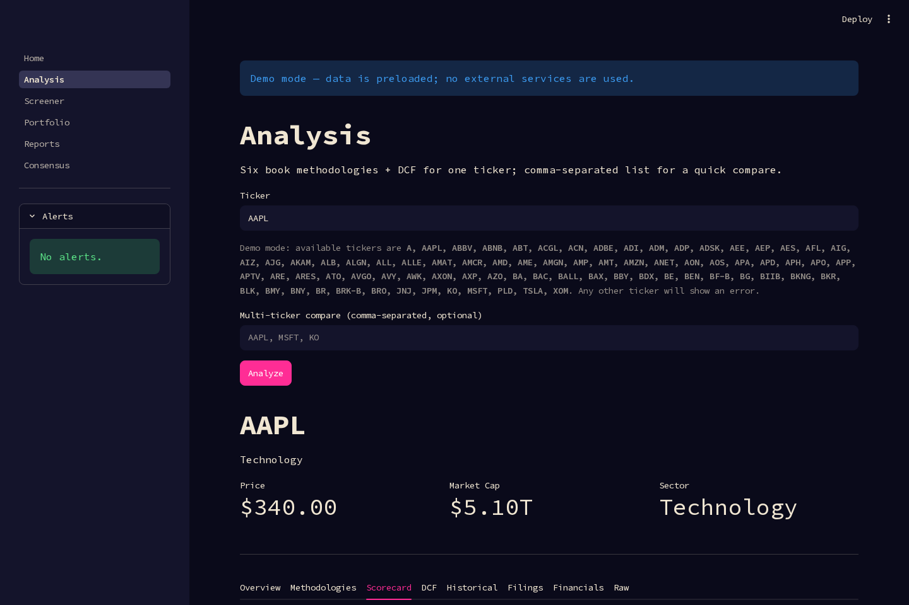

<p align="center">
  
</p>

# Value Investing

<p align="center">
  <a href="https://github.com/JdeJusto/Value_Investing/releases"></a>
  <a href="https://github.com/JdeJusto/Value_Investing/actions/workflows/ci.yml"></a>
  <a href="tests/unit"></a>
  <a href="LICENSE"></a>
  
  
  
  
</p>

<p align="center"><a href="README.md">English</a> · <a href="README.es.md">Español</a></p>

Terminal-first fundamental analysis for public companies. Scorecards, a
screener, eight independent investment methodologies (Graham, Graham & Dodd,
Lynch, Buffett-Classic, Buffett-Clark, Fisher, Greenblatt, Marks), consensus,
and DCF — in both CLI and Streamlit. Fundamentals are normalized from SEC
EDGAR into a local PostgreSQL database (Financial-DataBase).

## Install

Requires Python 3.13 and a PostgreSQL database populated by
[Financial-DataBase](https://github.com/JdeJusto/Financial-DataBase).

```bash
git clone https://github.com/JdeJusto/Value_Investing
cd Value_Investing
python -m pip install pipenv
PIPENV_VENV_IN_PROJECT=1 pipenv install --dev
pipenv shell
```

The commands below run from the repository root; `./vi` uses the project
virtualenv.

## CLI

```bash
./vi scorecard AAPL                           # Full scorecard with verdicts
./vi financials AAPL                          # Balance view (assets | liab+equity)
./vi financials AAPL --json                   # Structured JSON output
./vi rank --by graham --top 20                # Top tickers by methodology
./vi rank --combine graham,lynch --strategy and  # Intersection
./vi compare-methodologies AAPL                # Eight methodologies at a glance
./vi dcf AAPL                                 # DCF summary
./vi consensus AAPL --universe all             # Canonical consensus (all 8)
./vi portfolio view                           # Current portfolio
./vi screener --tickers AAPL,MSFT --no-prices --no-refresh  # Screen
./vi refresh AAPL                             # Re-fetch facts + prices for one ticker
```

`./vi --help` lists all 43 commands. All support `--no-color`;
`vi financials`, `vi rank`, and `vi refresh` also support `--json`.
`vi financials` shows a hierarchical T-view (current/non-current assets,
current/non-current liabilities, shareholders' equity) with per-section
subtotals. `vi refresh` syncs SEC facts and fetches the current Yahoo price
on demand; prices are not persisted to FDB.

## Streamlit



```bash
./run_ui.sh

# Or with demo data (no FDB required):
VI_DEMO=1 ./run_ui.sh
```

Opens at <http://localhost:8501>. Registered pages: Home, Analysis (overview,
financials, methodologies, DCF, filings), Screener, Portfolio, Reports,
Consensus. Methodology ranking is available from the CLI with `vi rank`.

## Daily workflow

```bash
python scripts/daily_workflow.py
```

Syncs SEC filings and Yahoo prices into FDB, evaluates alerts, and writes the
daily report. Supports `--resume` and health checks before each stage. Exit
codes: `0` success, `1` partial, `2` could not run. See
[`docs/runbook_daily.md`](docs/runbook_daily.md) for failure modes and recovery.

## Data (FDB)

Requires [Financial-DataBase](https://github.com/JdeJusto/Financial-DataBase)
at `~/Financial-DataBase` and a local PostgreSQL populated with SEC financial
facts, prices, and company metadata.

## Contributing

Issues and PRs are welcome.

```bash
pytest tests/unit tests/api             # tests
ruff check . && ruff format --check .   # lint
```

See [`docs/`](docs/) for design notes and [`docs/backlog.md`](docs/backlog.md)
for known issues.

## License

MIT — see [`LICENSE`](LICENSE).
